# Diagram (text to Mermaid)

Turn boring walls of text into a picture. Output a single mermaid code fence the user can read at a glance (and render with pele or any Mermaid renderer).

## When to use

- The user asks to "visualize", "diagram", "draw", "map", "flowchart", "show as a diagram", or "make this a picture".
- A long explanation of a process, system, architecture, relationship, hierarchy, timeline, decision tree, state machine, or comparison would be clearer visually.
- The user is skimming and wants to skip reading.

Do not diagram trivial one-liners or pure prose/narrative with no structure.

## Step 1 - Find the shape of the content

Before writing syntax, identify what the text actually is:

| Content shape | Diagram type |
|---|---|
| Steps / process / decision tree / branching logic | flowchart |
| Who talks to whom, request/response, protocol | sequenceDiagram |
| Hierarchy, taxonomy, brainstorm, concept map | mindmap |
| Object model, inheritance, domain model | classDiagram |
| Lifecycle, states, transitions, status flow | stateDiagram-v2 |
| Data model, entities and relations | erDiagram |
| Schedule, project plan, milestones | gantt |
| Proportions, distribution, share | pie |
| 2-axis positioning, prioritization matrix | quadrantChart |
| User experience over time | journey |
| Branching history, releases | gitGraph |
| Layout blocks, components in a grid | block |
| Flow/volume between stages | sankey-beta |
| Numeric series over categories | xychart-beta |
| Kanban board / work items by status | kanban |
| Nested proportions / budget breakdown | treemap-beta |
| Overlapping sets, Venn | venn-beta |
| System context / C4 architecture | C4Context |
| Decision-making domains (Cynefin) | cynefin-beta |
| Root-cause / fishbone | ishikawa-beta |
| Tree / file structure | treeView-beta |
| Packet / byte layout | packet-beta |
| Requirements and verification | requirementDiagram |
| Radar / skill matrix | radar-beta |
| Agent/workflow orchestration | agentflow-beta |

If two shapes fit, prefer the one with fewer nodes and clearer labels.

## Step 2 - Authoring rules (read before writing)

1. Short labels. 4-6 words per node max. Move detail to a caption or the original text.
2. Limit size. 20 nodes total max. If larger, split into 2-3 diagrams or aggregate.
3. One idea per diagram. Do not cram unrelated things together.
4. Quote labels with spaces/special chars in double quotes: A["User (admin)"].
5. Avoid Mermaid reserved words as bare node ids (end, graph, etc.); use ids like n1, a1.
6. Group with subgraphs when there are clear clusters.
7. Keep edge labels short (-- yes -->), or omit.
8. Validate by rendering with pele when available (see below) before finalizing.

## Step 3 - Syntax cheat sheet

### flowchart
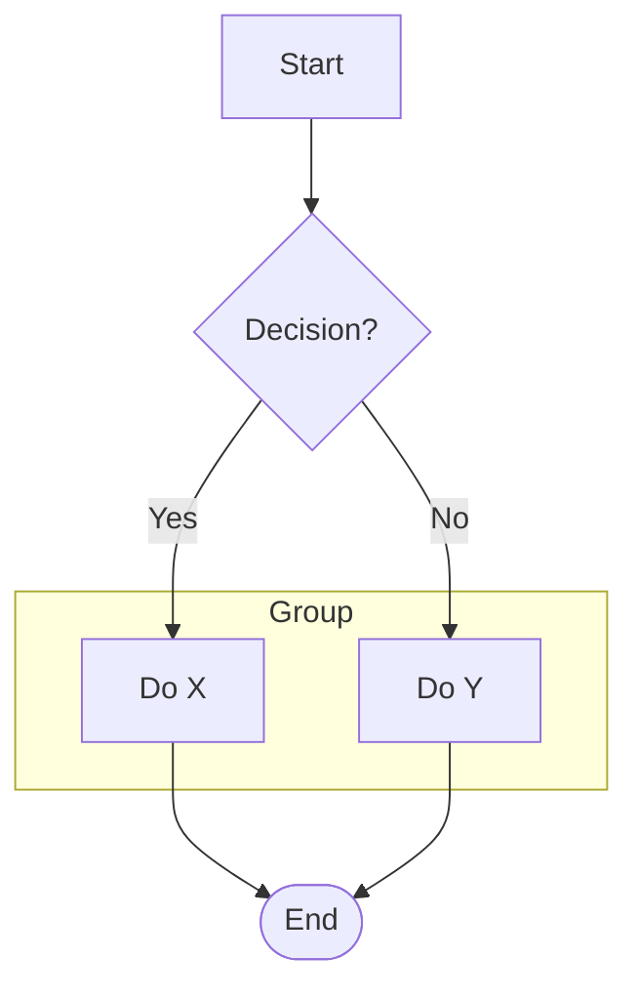
Shapes: [] rect, () rounded, ([]) stadium, {} diamond, [()] cylinder, (( )) circle.

### mindmap
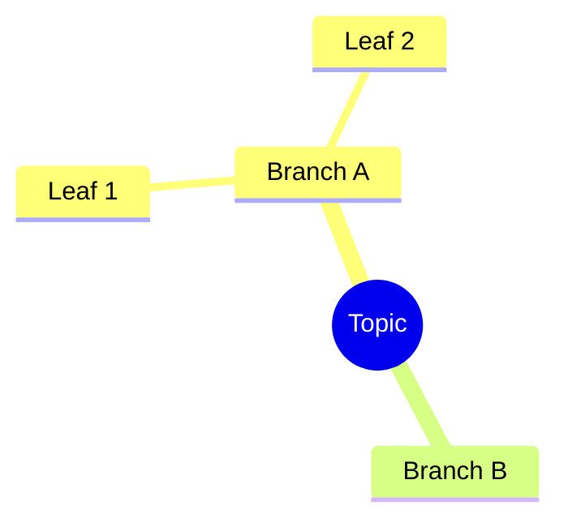

### sequenceDiagram
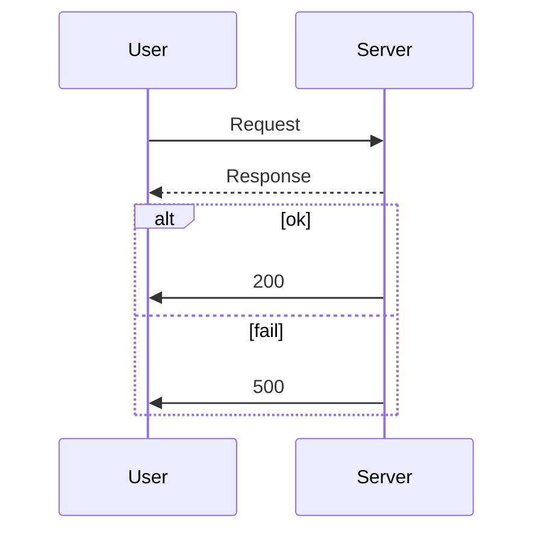

### timeline
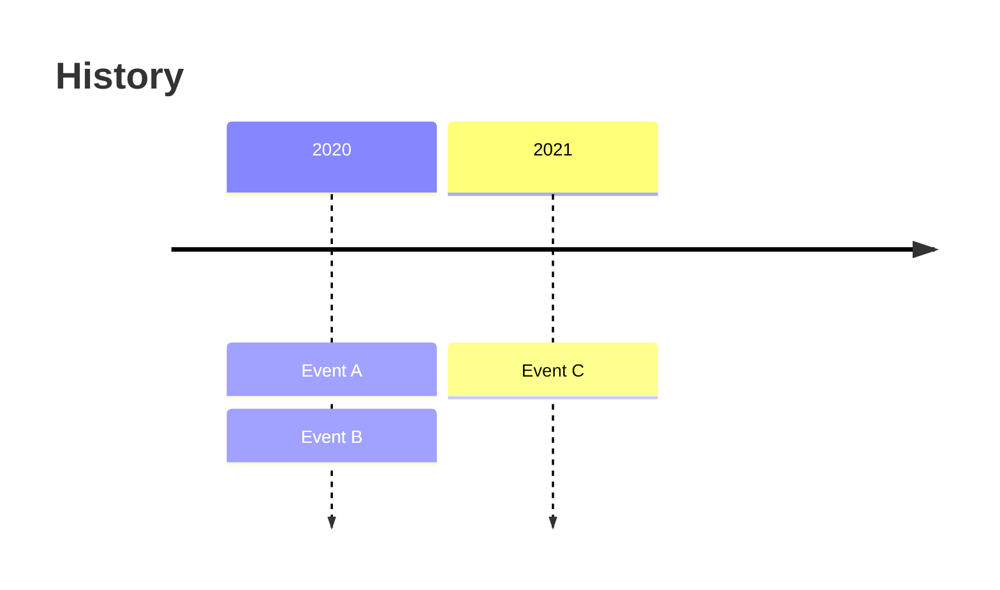

### classDiagram
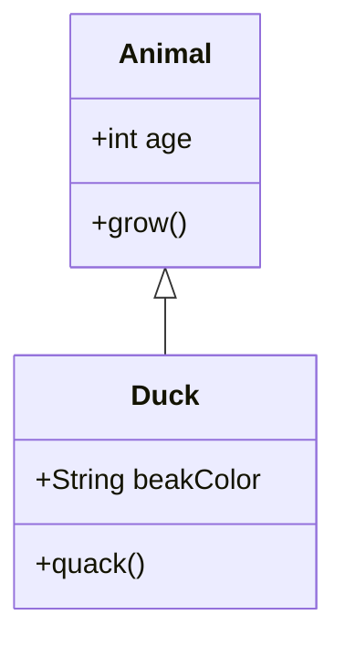

### stateDiagram-v2
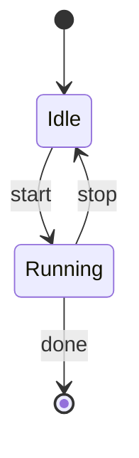

### erDiagram
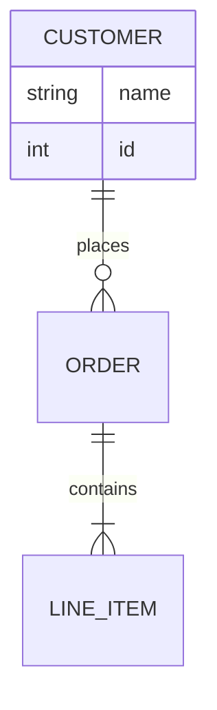

### gantt
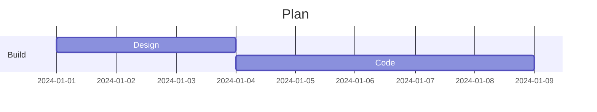

### pie
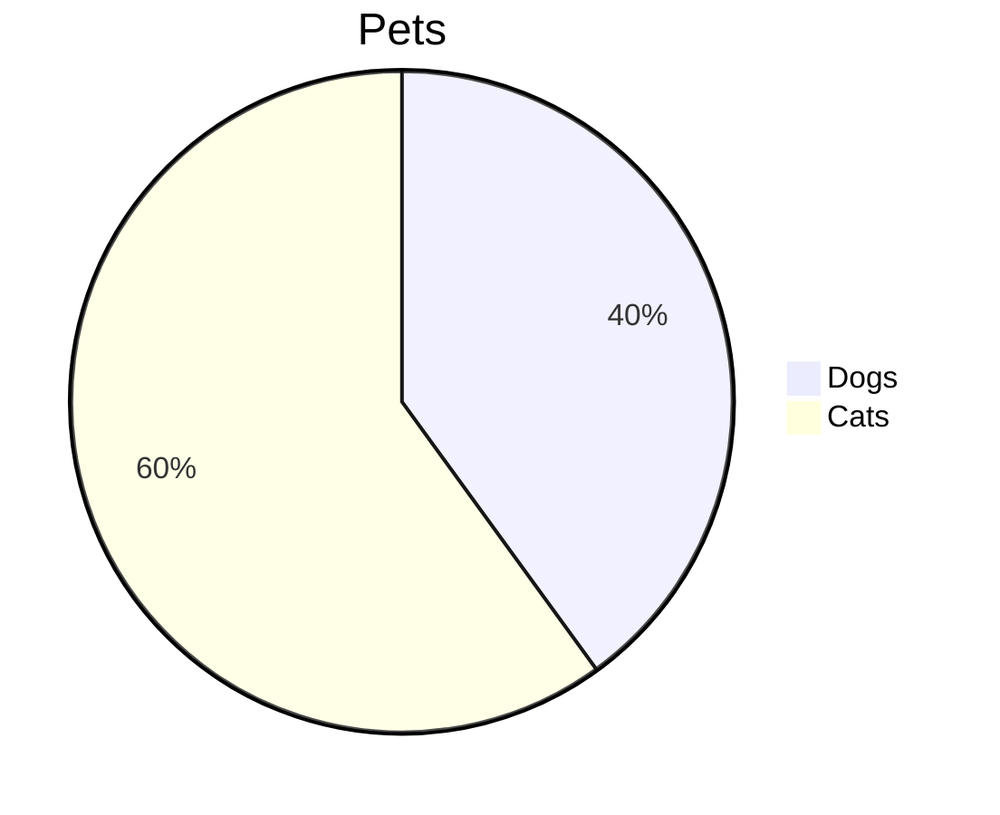

### quadrantChart
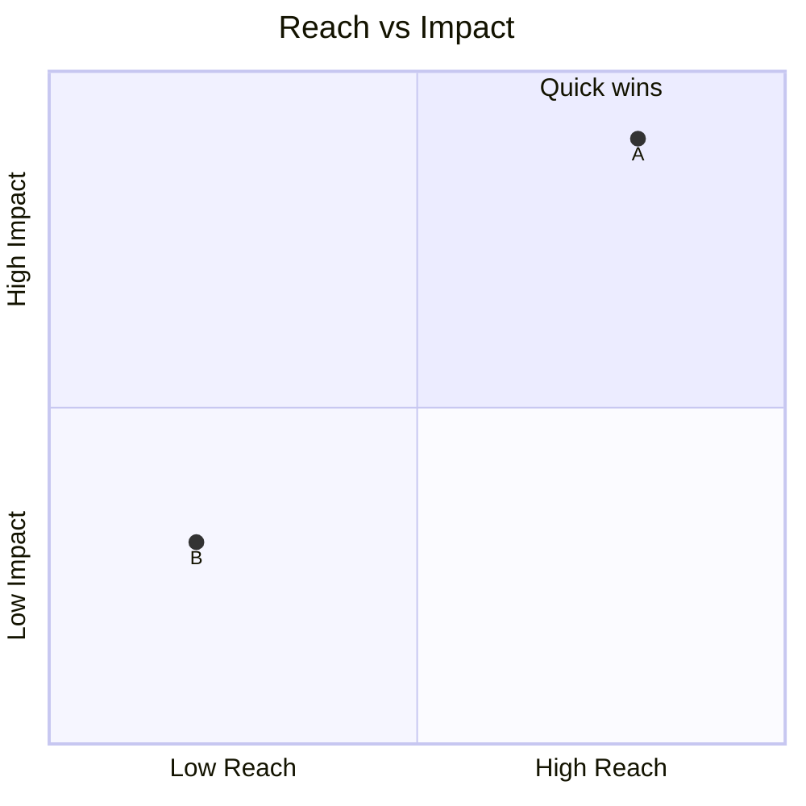

### journey
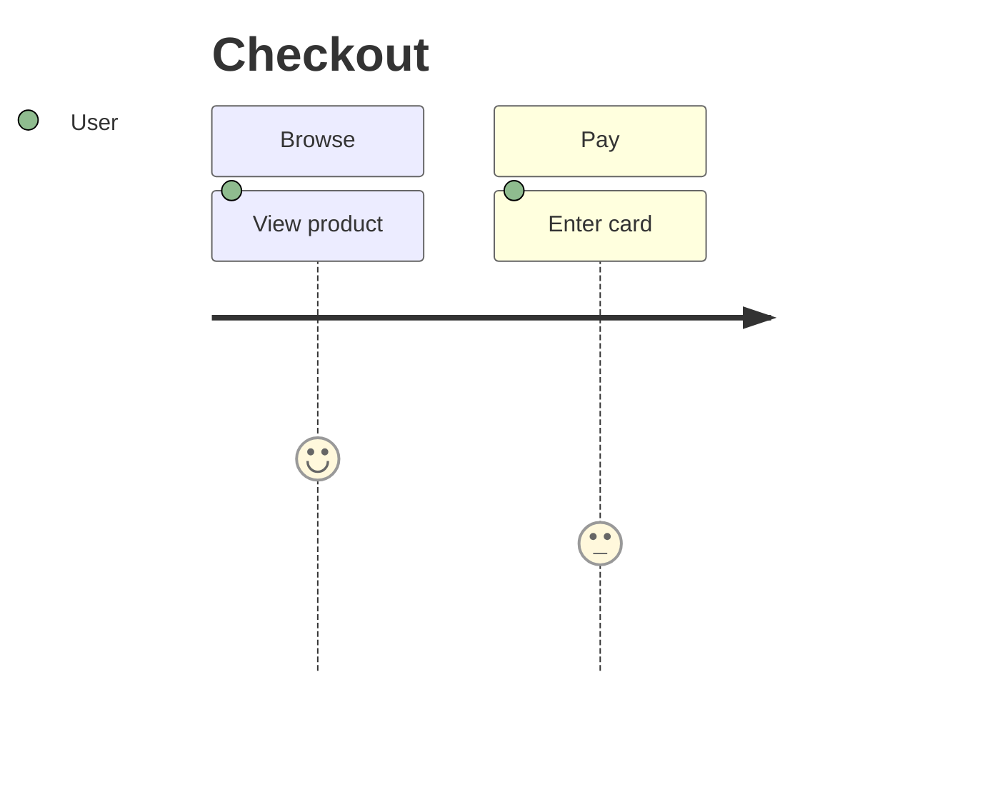

### gitGraph
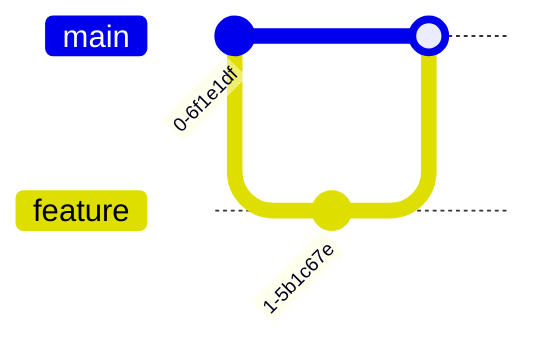

### block
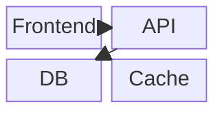

### sankey-beta
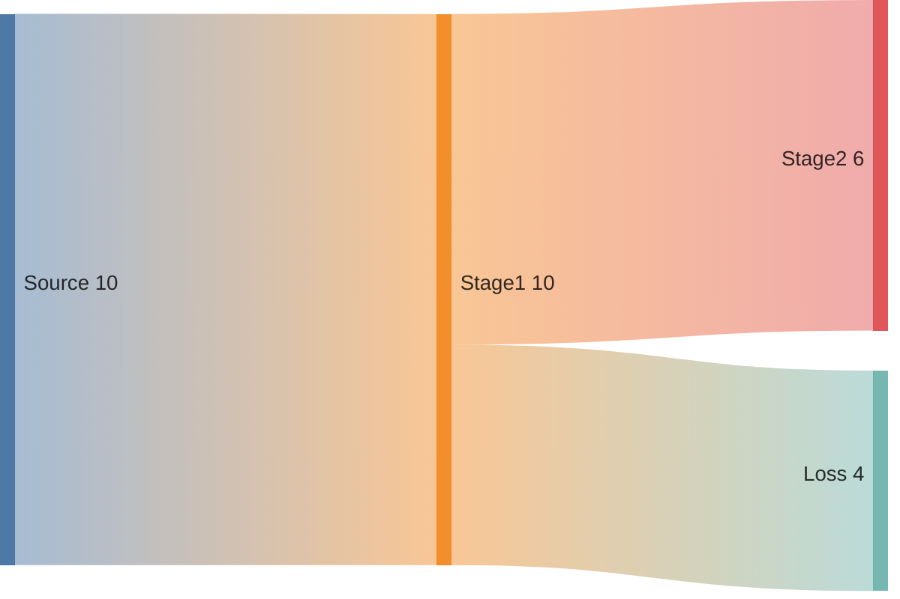

### xychart-beta
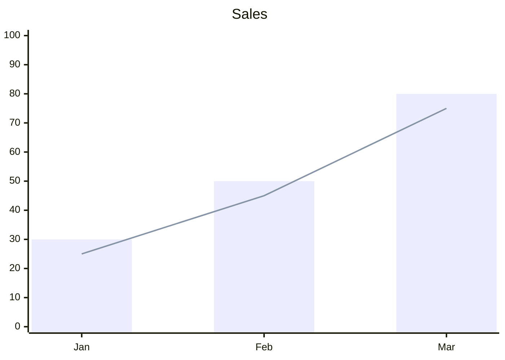

### kanban
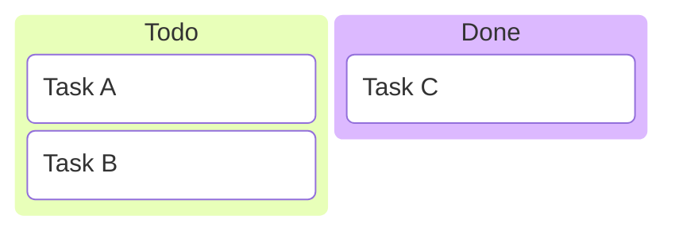

### treemap-beta
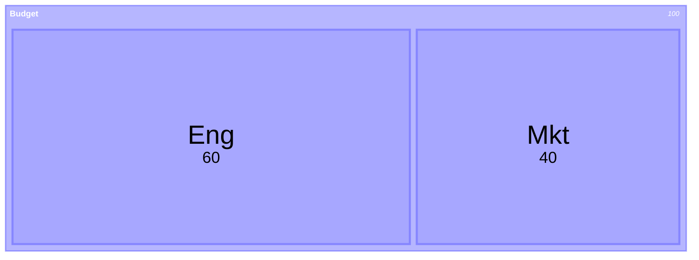

### venn-beta
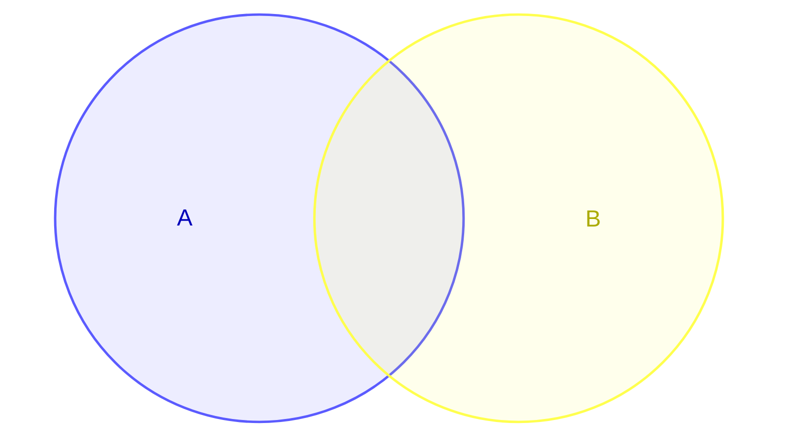

### C4Context
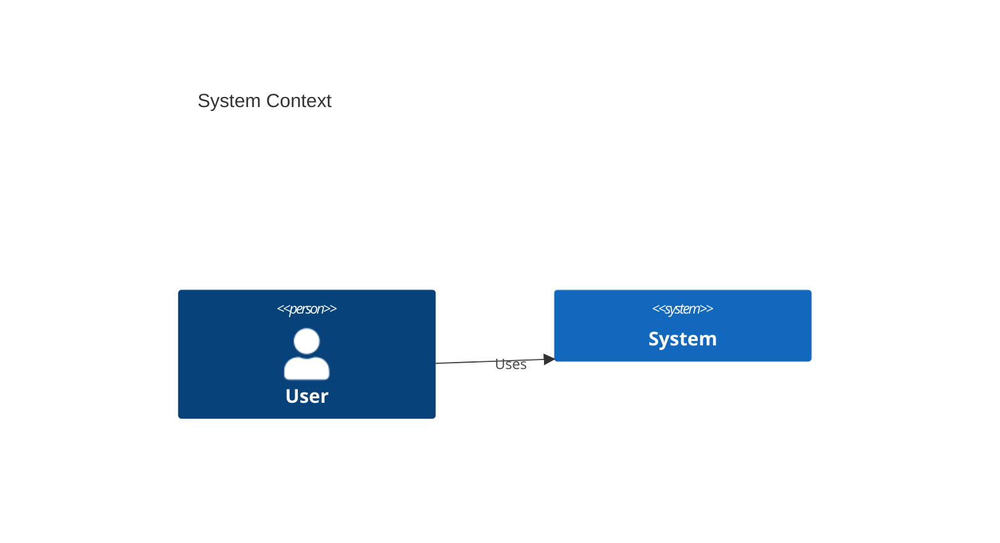

### agentflow-beta
```mermaid
agentflow-beta
  A[Trigger] --> B[Agent]
  B --> C{Tool?}
  C -- yes --> D[Call tool]
  D --> B
```

### cynefin-beta
```mermaid
cynefin-beta
  title Domains
```

### ishikawa-beta
```mermaid
ishikawa-beta
  title Problem
  Cause A
  Cause B
```

### treeView-beta
```mermaid
treeView-beta
  Root
    Child A
    Child B
```

### packet-beta
```mermaid
packet-beta
  0-7: "Header"
  8-15: "Type"
```

### requirementDiagram
```mermaid
requirementDiagram
  requirement r1 {
    id: 1
    text: the system shall X
    risk: high
    verifymethod: test
  }
```

### radar-beta
```mermaid
radar-beta
  title Skills
  axis A, B, C
  curve c1{1, 2, 3}
```

## Step 4 - Render with pele (optional, when available)

If the project uses pele (or you can install it), render the diagram to an SVG file so the user sees the picture immediately:

```js
// render.mjs
import { writeFileSync } from 'node:fs';
import { render } from 'pele';
const src = `flowchart LR
  A[Mermaid text] --> B[SVG]`;
const { svg } = render(src);
writeFileSync('diagram.svg', svg);
console.log('written');
```

Run with: node render.mjs. pele is synchronous and has no runtime deps.

If pele is not available, the mermaid code fence alone is enough - Obsidian, GitHub, and most markdown viewers render it.

## Output format

Always deliver:

1. A one-line caption describing what the diagram shows.
2. The diagram in a fenced block:

   ```markdown
   ```mermaid
   <diagram>
   ```
   ```

3. (Optional) the rendered .svg if pele is available and the user wants a file.

Keep the diagram the star - do not re-explain the text you just diagrammed. A short caption plus the diagram is the whole answer.